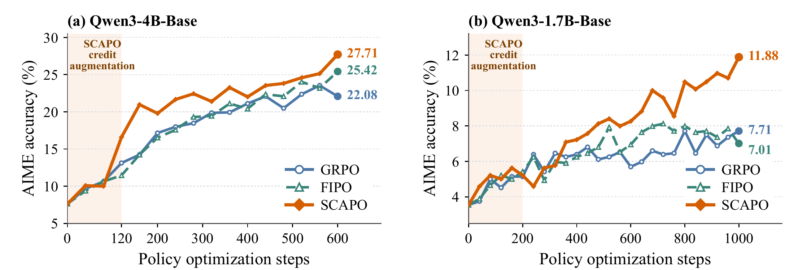

<div align="center">
  <h1>Semifactual Credit-Augmented Policy Optimization</h1>
  <p>
    <a href="https://arxiv.org/abs/2609.40360">📖 <b>Paper</b></a>
  </p>
</div>

**SCAPO** refines token-level credit assignment in RLVR using answer-preserving semifactual prompt perturbations. It measures token probability drift for fixed responses and lowers the advantages of relatively unstable tokens.

<p align="center">
  
</p>

---

## Contents

- [Main Results](#main-results)
- [Installation](#installation)
- [Data](#data)
- [Training](#training)
- [Evaluation](#evaluation)
- [Acknowledgments](#acknowledgments)
- [Citation](#citation)

<a name="main-results"></a>

## Main Results

### Qwen3-4B-Base

| Method | AIME 24–26 | AMC 23–25 | HMMT 25–26 | ID Avg. | OOD Avg. |
| --- | ---: | ---: | ---: | ---: | ---: |
| Base | 7.64 | 37.40 | 2.08 | 21.88 | 15.68 |
| GRPO | 22.08 | 59.74 | 11.71 | 34.93 | 26.48 |
| GSPO | 23.47 | 64.71 | 13.69 | 36.97 | 28.05 |
| SAPO | 24.03 | <ins>65.45</ins> | 15.18 | 37.43 | 28.35 |
| CF-GRPO | 22.64 | 62.06 | 14.09 | 36.29 | 27.26 |
| FIPO | <ins>25.42</ins> | 64.57 | <ins>15.28</ins> | <ins>38.64</ins> | <ins>28.59</ins> |
| **SCAPO** | **27.71** | **65.65** | **16.17** | **39.65** | **30.72** |

### Qwen3-1.7B-Base

| Method | AIME 24–26 | AMC 23–25 | HMMT 25–26 | ID Avg. | OOD Avg. |
| --- | ---: | ---: | ---: | ---: | ---: |
| Base | 3.61 | 23.33 | 0.69 | 12.45 | 9.31 |
| GRPO | 7.71 | 32.97 | 1.98 | 17.86 | 13.70 |
| GSPO | 7.36 | 32.82 | 2.08 | 17.92 | 14.13 |
| SAPO | <ins>10.00</ins> | <ins>38.58</ins> | <ins>4.66</ins> | <ins>21.46</ins> | <ins>16.20</ins> |
| CF-GRPO | 6.74 | 31.99 | 2.98 | 18.39 | 13.72 |
| FIPO | 7.01 | 32.48 | 1.49 | 17.73 | 13.95 |
| **SCAPO** | **11.88** | **41.39** | **4.96** | **23.08** | **17.22** |

<details>
<summary><b>Full benchmark results</b></summary>

### Qwen3-4B-Base

<table>
  <thead>
    <tr>
      <th rowspan="2" align="left">Method</th>
      <th colspan="9" align="center">In-distribution (ID)</th>
      <th colspan="4" align="center">Out-of-distribution (OOD)</th>
    </tr>
    <tr>
      <th align="center">AIME<br>24&#8288;–&#8288;26</th>
      <th align="center">AMC<br>23&#8288;–&#8288;25</th>
      <th align="center">HMMT<br>25&#8288;–&#8288;26</th>
      <th align="center">BRUMO<br>25</th>
      <th align="center">SMT<br>25</th>
      <th align="center">Omni-Math</th>
      <th align="center">Minerva</th>
      <th align="center">Olympiad</th>
      <th align="center">Avg.</th>
      <th align="center">NoOp-AIME<br>24&#8288;–&#8288;26</th>
      <th align="center">ThinkBench-AIME<br>24&#8288;–&#8288;26</th>
      <th align="center">GPQA<br>Diamond</th>
      <th align="center">Avg.</th>
    </tr>
  </thead>
  <tbody>
    <tr>
      <td align="left">Base</td>
      <td align="right">7.64</td>
      <td align="right">37.40</td>
      <td align="right">2.08</td>
      <td align="right">18.54</td>
      <td align="right">12.74</td>
      <td align="right">26.48</td>
      <td align="right">31.62</td>
      <td align="right">38.58</td>
      <td align="right">21.88</td>
      <td align="right">6.74</td>
      <td align="right">6.53</td>
      <td align="right">33.78</td>
      <td align="right">15.68</td>
    </tr>
    <tr>
      <td align="left">GRPO</td>
      <td align="right">22.08</td>
      <td align="right">59.74</td>
      <td align="right">11.71</td>
      <td align="right">28.96</td>
      <td align="right">27.12</td>
      <td align="right">35.45</td>
      <td align="right">40.07</td>
      <td align="right">54.30</td>
      <td align="right">34.93</td>
      <td align="right">20.56</td>
      <td align="right">22.64</td>
      <td align="right">36.26</td>
      <td align="right">26.48</td>
    </tr>
    <tr>
      <td align="left">GSPO</td>
      <td align="right">23.47</td>
      <td align="right">64.71</td>
      <td align="right">13.69</td>
      <td align="right">33.75</td>
      <td align="right">26.06</td>
      <td align="right"><ins>38.71</ins></td>
      <td align="right">39.71</td>
      <td align="right">55.64</td>
      <td align="right">36.97</td>
      <td align="right">20.14</td>
      <td align="right">22.08</td>
      <td align="right"><ins>41.92</ins></td>
      <td align="right">28.05</td>
    </tr>
    <tr>
      <td align="left">SAPO</td>
      <td align="right">24.03</td>
      <td align="right"><ins>65.45</ins></td>
      <td align="right">15.18</td>
      <td align="right">33.54</td>
      <td align="right">27.12</td>
      <td align="right">38.18</td>
      <td align="right">41.18</td>
      <td align="right">54.75</td>
      <td align="right">37.43</td>
      <td align="right">20.42</td>
      <td align="right">23.47</td>
      <td align="right">41.16</td>
      <td align="right">28.35</td>
    </tr>
    <tr>
      <td align="left">CF&#8209;GRPO</td>
      <td align="right">22.64</td>
      <td align="right">62.06</td>
      <td align="right">14.09</td>
      <td align="right">32.08</td>
      <td align="right">26.77</td>
      <td align="right">36.41</td>
      <td align="right">41.54</td>
      <td align="right">54.75</td>
      <td align="right">36.29</td>
      <td align="right"><ins>21.74</ins></td>
      <td align="right">23.54</td>
      <td align="right">36.51</td>
      <td align="right">27.26</td>
    </tr>
    <tr>
      <td align="left">FIPO</td>
      <td align="right"><ins>25.42</ins></td>
      <td align="right">64.57</td>
      <td align="right"><ins>15.28</ins></td>
      <td align="right"><ins>35.00</ins></td>
      <td align="right"><ins>28.18</ins></td>
      <td align="right">38.60</td>
      <td align="right"><strong>44.49</strong></td>
      <td align="right"><strong>57.57</strong></td>
      <td align="right"><ins>38.64</ins></td>
      <td align="right"><ins>21.74</ins></td>
      <td align="right"><ins>23.89</ins></td>
      <td align="right">40.15</td>
      <td align="right"><ins>28.59</ins></td>
    </tr>
    <tr>
      <td align="left"><strong>SCAPO</strong></td>
      <td align="right"><strong>27.71</strong></td>
      <td align="right"><strong>65.65</strong></td>
      <td align="right"><strong>16.17</strong></td>
      <td align="right"><strong>37.71</strong></td>
      <td align="right"><strong>30.31</strong></td>
      <td align="right"><strong>39.42</strong></td>
      <td align="right"><ins>43.38</ins></td>
      <td align="right"><ins>56.82</ins></td>
      <td align="right"><strong>39.65</strong></td>
      <td align="right"><strong>23.61</strong></td>
      <td align="right"><strong>26.11</strong></td>
      <td align="right"><strong>42.45</strong></td>
      <td align="right"><strong>30.72</strong></td>
    </tr>
  </tbody>
</table>

### Qwen3-1.7B-Base

<table>
  <thead>
    <tr>
      <th rowspan="2" align="left">Method</th>
      <th colspan="9" align="center">In-distribution (ID)</th>
      <th colspan="4" align="center">Out-of-distribution (OOD)</th>
    </tr>
    <tr>
      <th align="center">AIME<br>24&#8288;–&#8288;26</th>
      <th align="center">AMC<br>23&#8288;–&#8288;25</th>
      <th align="center">HMMT<br>25&#8288;–&#8288;26</th>
      <th align="center">BRUMO<br>25</th>
      <th align="center">SMT<br>25</th>
      <th align="center">Omni-Math</th>
      <th align="center">Minerva</th>
      <th align="center">Olympiad</th>
      <th align="center">Avg.</th>
      <th align="center">NoOp-AIME<br>24&#8288;–&#8288;26</th>
      <th align="center">ThinkBench-AIME<br>24&#8288;–&#8288;26</th>
      <th align="center">GPQA<br>Diamond</th>
      <th align="center">Avg.</th>
    </tr>
  </thead>
  <tbody>
    <tr>
      <td align="left">Base</td>
      <td align="right">3.61</td>
      <td align="right">23.33</td>
      <td align="right">0.69</td>
      <td align="right">6.88</td>
      <td align="right">4.83</td>
      <td align="right">16.73</td>
      <td align="right">21.69</td>
      <td align="right">21.81</td>
      <td align="right">12.45</td>
      <td align="right">2.36</td>
      <td align="right">3.19</td>
      <td align="right">22.37</td>
      <td align="right">9.31</td>
    </tr>
    <tr>
      <td align="left">GRPO</td>
      <td align="right">7.71</td>
      <td align="right">32.97</td>
      <td align="right">1.98</td>
      <td align="right">13.54</td>
      <td align="right">6.96</td>
      <td align="right">20.45</td>
      <td align="right">27.94</td>
      <td align="right">31.31</td>
      <td align="right">17.86</td>
      <td align="right">6.11</td>
      <td align="right">7.57</td>
      <td align="right">27.42</td>
      <td align="right">13.70</td>
    </tr>
    <tr>
      <td align="left">GSPO</td>
      <td align="right">7.36</td>
      <td align="right">32.82</td>
      <td align="right">2.08</td>
      <td align="right">11.88</td>
      <td align="right">6.84</td>
      <td align="right">21.48</td>
      <td align="right">27.21</td>
      <td align="right">33.68</td>
      <td align="right">17.92</td>
      <td align="right">5.97</td>
      <td align="right">7.22</td>
      <td align="right">29.21</td>
      <td align="right">14.13</td>
    </tr>
    <tr>
      <td align="left">SAPO</td>
      <td align="right"><ins>10.00</ins></td>
      <td align="right"><ins>38.58</ins></td>
      <td align="right"><ins>4.66</ins></td>
      <td align="right"><ins>17.71</ins></td>
      <td align="right"><ins>10.14</ins></td>
      <td align="right"><ins>22.62</ins></td>
      <td align="right"><ins>30.15</ins></td>
      <td align="right"><ins>37.83</ins></td>
      <td align="right"><ins>21.46</ins></td>
      <td align="right"><ins>8.06</ins></td>
      <td align="right"><ins>9.58</ins></td>
      <td align="right"><ins>30.96</ins></td>
      <td align="right"><ins>16.20</ins></td>
    </tr>
    <tr>
      <td align="left">CF&#8209;GRPO</td>
      <td align="right">6.74</td>
      <td align="right">31.99</td>
      <td align="right">2.98</td>
      <td align="right">14.37</td>
      <td align="right">8.02</td>
      <td align="right">20.77</td>
      <td align="right">28.31</td>
      <td align="right">33.98</td>
      <td align="right">18.39</td>
      <td align="right">6.60</td>
      <td align="right">6.94</td>
      <td align="right">27.61</td>
      <td align="right">13.72</td>
    </tr>
    <tr>
      <td align="left">FIPO</td>
      <td align="right">7.01</td>
      <td align="right">32.48</td>
      <td align="right">1.49</td>
      <td align="right">10.00</td>
      <td align="right">8.14</td>
      <td align="right">21.77</td>
      <td align="right">28.31</td>
      <td align="right">32.64</td>
      <td align="right">17.73</td>
      <td align="right">6.60</td>
      <td align="right">7.01</td>
      <td align="right">28.24</td>
      <td align="right">13.95</td>
    </tr>
    <tr>
      <td align="left"><strong>SCAPO</strong></td>
      <td align="right"><strong>11.88</strong></td>
      <td align="right"><strong>41.39</strong></td>
      <td align="right"><strong>4.96</strong></td>
      <td align="right"><strong>19.17</strong></td>
      <td align="right"><strong>10.85</strong></td>
      <td align="right"><strong>24.74</strong></td>
      <td align="right"><strong>30.88</strong></td>
      <td align="right"><strong>40.80</strong></td>
      <td align="right"><strong>23.08</strong></td>
      <td align="right"><strong>8.40</strong></td>
      <td align="right"><strong>12.01</strong></td>
      <td align="right"><strong>31.25</strong></td>
      <td align="right"><strong>17.22</strong></td>
    </tr>
  </tbody>
</table>


</details>

<a name="installation"></a>

## Installation

We recommend using the [official EasyR1 Docker image](https://github.com/hiyouga/EasyR1#software-requirements). Inside the container, clone this repository and install the project:

```bash
git clone https://github.com/DtYXs/SCAPO.git
cd SCAPO
pip install -e ./EasyR1
```

Alternatively, you can create your own Conda environment:

```bash
conda create -n scapo python=3.12 -y
conda activate scapo

git clone https://github.com/DtYXs/SCAPO.git
cd SCAPO
pip install uv
uv pip install --python "$CONDA_PREFIX/bin/python" torch==2.8.0 torchvision==0.23.0 torchaudio==2.8.0 --index-url https://download.pytorch.org/whl/cu128
uv pip install --python "$CONDA_PREFIX/bin/python" -e ./EasyR1
pip install flash-attn==2.8.3 --no-build-isolation
```

<a name="data"></a>

## Data

We train on [DAPO-Math-17K](https://huggingface.co/datasets/BytedTsinghua-SIA/DAPO-Math-17k), paired with our [semifactual prompt dataset](data/train/dapo17k_semifactual.jsonl), which supplies four answer-preserving perturbations per problem. The training data, perturbation prompts, and math evaluation datasets are included in the [data directory](data/).

<a name="training"></a>

## Training

```bash
bash scripts/train.sh scapo 4b --model-path Qwen/Qwen3-4B-Base --gpus 0,1,2,3,4,5,6,7

bash scripts/train.sh scapo 1.7b --model-path Qwen/Qwen3-1.7B-Base --gpus 0,1,2,3,4,5,6,7
```

Replace `scapo` with `grpo`, `gspo`, `sapo`, `cf_grpo`, or `fipo` to train a baseline.

We run experiments on 8 GPUs. The final checkpoint will be merged automatically after training. To merge a saved checkpoint manually, run the command below.

<details>
<summary><b>Merge a saved checkpoint</b></summary>

```bash
python EasyR1/scripts/model_merger.py --local_dir outputs/scapo_4b/global_step_300/actor
```

</details>

<a name="evaluation"></a>

## Evaluation

Evaluate the benchmarks in our paper:

```bash
bash scripts/eval.sh \
  --model outputs/scapo_4b/global_step_300/actor/huggingface \
  --output-dir outputs/eval/scapo_4b \
  --gpus 0,1,2,3,4,5,6,7
```

To evaluate a single benchmark, add `--benchmark`:

```bash
bash scripts/eval.sh --model Qwen/Qwen3-4B-Base --benchmark aime2024
```

See [data/README.md](data/README.md) for more details.

<a name="acknowledgments"></a>

## Acknowledgments

We gratefully acknowledge the excellent open-source contributions of [EasyR1](https://github.com/hiyouga/EasyR1), [verl](https://github.com/volcengine/verl), and [Math-Verify](https://github.com/huggingface/Math-Verify), which have greatly supported our research. We also thank the authors of the baseline methods and datasets used in this work.

<a name="citation"></a>

## Citation

```bibtex
@misc{pan2026semifactualcreditaugmentedpolicyoptimization,
  title         = {Semifactual Credit-Augmented Policy Optimization},
  author        = {Junshu Pan and Zhizhang Fu and Shulin Huang and Yiran Ding and Zifan Cheng and Wenqi Shao and Qiaosheng Zhang and Yue Zhang},
  year          = {2026},
  eprint        = {2609.40360},
  archivePrefix = {arXiv},
  primaryClass  = {cs.LG},
  url           = {https://arxiv.org/abs/2609.40360}
}
```
